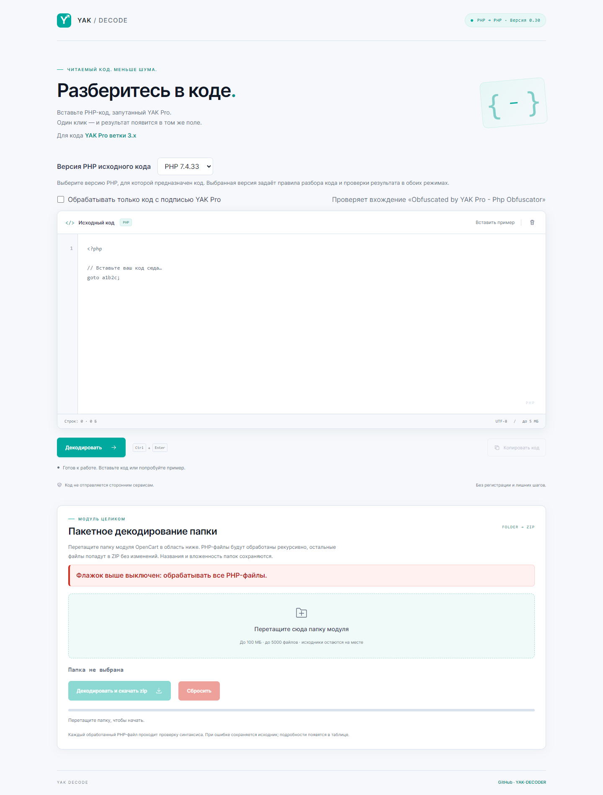

# YAK Decoder v3 · 0.30

Локальный декодер PHP-кода после обфускации [YAK Pro 3.x (ветка master)](https://github.com/pk-fr/yakpro-po/tree/master). Восстанавливает условия и циклы из переходов `goto`, раскрывает экранированные строки и форматирует код. Использует PHP-Parser 5.9.0 и позволяет выбрать целевую версию PHP: 7.4, 8.1, 8.2 или 8.3.



## Запуск

1. Распакуйте комплект целиком и на Windows x64 запустите `start.cmd`.
2. Откроется [локальная страница](http://127.0.0.1:18090/). Оставьте окно сервера открытым.
3. Выберите версию PHP исходного кода, вставьте код и нажмите «Декодировать» или Ctrl+Enter.
4. Результат заменит текст в поле. Кнопка «Вернуть исходник» восстанавливает введённый код.
5. Для остановки сервера нажмите Ctrl+C в его окне.

PHP и необходимые DLL входят в комплект. Для обычной работы не нужны Composer, Python, Node.js, настройка PATH или интернет. Сохраняйте папку `runtime/` и лицензии при переносе проекта.

Входящий PHP не исполняется: декодер разбирает его как текст, а результат проверяет через `php --syntax-check`. Код не отправляется сторонним сервисам.

## Выбор версии PHP

Версия в списке задаёт правила разбора, вывода и итоговой проверки синтаксиса. По умолчанию выбрана **7.4**. Выбор общий для одиночной и пакетной обработки; для папки с разными целевыми версиями PHP запускайте отдельные обработки.

| Выбор | Встроенный PHP для проверки синтаксиса |
|---|---|
| 7.4 | PHP 7.4.33 — `runtime/php/` |
| 8.1 | PHP 8.1.34 — `runtime/php81/` |
| 8.2 | PHP 8.2.35 — `runtime/php82/` |
| 8.3 | PHP 8.3.36 — `runtime/php83/` |

Сервер и процесс декодера используют PHP 7.4.33; выходной синтаксис проверяет интерпретатор выбранной версии. Выбор PHP не переносит программу на другую версию и не заменяет проверку её совместимости.

## Пакетная обработка

Перетащите папку в область пакетного декодирования и нажмите «Декодировать и скачать ZIP». Исходная папка на диске не изменяется.

- Обрабатываются `.php`, `.php0`–`.php9`, `.phtml`, `.inc` и `.tpl` с PHP-тегами, включая смешанный HTML/PHP.
- Структура путей, имя корневой папки и пустые папки сохраняются. Остальные файлы, включая скрытые, копируются побайтно.
- PHP-файлы передаются локальному серверу последовательно. ZIP собирается в браузере: STORE без сжатия, UTF-8 имена и CRC-32.
- Если остались `goto`, в ZIP попадёт частичный результат после проверки синтаксиса. При ошибке декодирования или lint, неподходящей кодировке либо превышении размера сохраняется исходный файл.
- Обработку можно остановить. После завершения доступны журнал, статистика и ссылка для повторного скачивания ZIP.

Если есть частичные результаты, предупреждения или ошибки, в корень ZIP добавляется `yak-decoder-report.txt`: выбранная версия PHP, отдельные разделы с путями и причинами. Если имя занято, выбирается свободное имя с числовым суффиксом. При полном успехе отчёт не создаётся.

## Фильтр подписи YAK Pro

Флажок «Обрабатывать только код с подписью YAK Pro» общий для обоих режимов и по умолчанию выключен. При включении требуется точная строка с учётом регистра:

```text
Obfuscated by YAK Pro - Php Obfuscator
```

Версия, дата и оформление комментария могут отличаться. Без строки одиночная обработка выдаёт ошибку и сохраняет введённый код, пакетная копирует файл без изменений. Проверка выполняется в браузере и на сервере. Наличие строки не подтверждает происхождение файла.

## Лимиты и ограничения

| Параметр | Значение |
|---|---:|
| Один PHP-файл или фрагмент | 5 МиБ |
| JSON-запрос | 32 МиБ |
| Файлов в пакете / записей ZIP с папками и отчётом | 5000 / 10000 |
| Суммарный вход / результат пакета | 100 / 150 МиБ |
| Память декодера / буфер ответа процесса | 2 ГиБ / 64 МиБ |
| Время декодирования / проверки синтаксиса | 25 / 5 секунд |

Интерфейс использует подпись «МБ»; размеры рассчитаны кратно 1024. Настройки и места их изменения — в [LIMITS.txt](LIMITS.txt). Размер ZIP может превышать суммарный размер файлов из-за заголовков и добавленного отчёта.

Ноль `goto` и успешная проверка синтаксиса не доказывают эквивалентность программы. Перед использованием результата проверяйте поведение и зависимости в подходящем окружении. Поддержка конкретного файла зависит от конструкций и графа управления: неподдержанные участки сохраняются с `goto` и предупреждением.

Имена переменных и функций, заменённые обфускатором, автоматически не восстанавливаются. Декодер сохраняет поведение обфусцированного входа; ошибки самого обфускатора автоматически не исправляются.

## Размещение на другом сервере

DocumentRoot должен указывать на `public/`. Нужны PHP CLI, разрешённый `proc_open`, доступ к интерпретаторам проверки синтаксиса и возможность создавать временные файлы. Для комплектного запуска сохраняйте все четыре папки PHP в `runtime/`. Процессы используют `-n`, без системного `php.ini`.

Комплект подготовлен для Windows x64. Перенос на другую ОС требует адаптации путей к CLI и интерпретаторам проверки синтаксиса. Встроенный сервер из `start.cmd` предназначен для локального запуска и слушает `127.0.0.1`.

[Устройство и правила доработки](PROJECT_HANDOFF.md) · [Исправления декодера](HANDOFF_DECODER_FIXES.md) · [Лимиты](LIMITS.txt) · [Тестовые наборы](tests/cases/README.md) · [Репозиторий](https://github.com/pomansurdev/YAK-DECODER)
