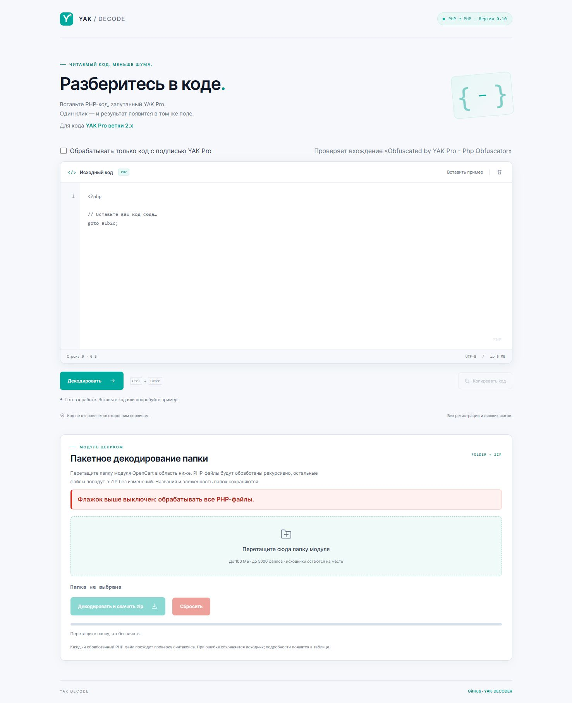

# YAK Decoder · 0.10

Локальный декодер PHP-кода после [YAK Pro 2.x](https://github.com/pk-fr/yakpro-po/tree/2.x). Восстанавливает условия и циклы из переходов `goto`, раскрывает экранированные строки и форматирует код. Проверен с YAK Pro 2.0.17, PHP 7.4.33 и PHP-Parser 4.19.4.



## Запуск

1. Скачайте и распакуйте весь проект из ветки `2.x`.
2. На Windows x64 запустите `start.cmd`. Откроется [локальная страница](http://127.0.0.1:18090/).
3. Вставьте код и нажмите «Декодировать» или Ctrl+Enter. Кнопка «Вернуть исходник» восстанавливает введённый текст.
4. Для остановки сервера нажмите Ctrl+C в его окне.

PHP и необходимые DLL входят в комплект. Для работы не нужны Composer, Python, Node.js, настройка PATH или интернет. Сохраняйте `runtime/` и лицензии при переносе проекта.

Входящий PHP не исполняется: декодер разбирает его как текст, а результат проверяет через `php --syntax-check`. Код не отправляется сторонним сервисам.

## Пакетная обработка

Перетащите папку в область пакетного декодирования и нажмите «Декодировать и скачать zip». Исходная папка не изменяется.

- Обрабатываются `.php`, `.php0`–`.php9`, `.phtml`, `.inc` и `.tpl` с PHP-тегами, включая смешанный HTML/PHP.
- Структура путей, имя корневой папки и пустые папки сохраняются. Остальные файлы копируются побайтно.
- PHP-файлы передаются локальному серверу последовательно. ZIP собирается в браузере: STORE без сжатия, UTF-8 имена, CRC-32.
- Если остались `goto`, в ZIP попадёт частичный результат после проверки синтаксиса. При ошибке, неподходящей кодировке или превышении размера сохраняется исходный файл.
- При частичных результатах, предупреждениях или ошибках в корень ZIP добавляется `yak-decoder-report.txt`. Если имя занято, выбирается числовой суффикс. При полном успехе отчёт не создаётся.

Флажок «Обрабатывать только код с подписью YAK Pro» общий для обоих режимов и по умолчанию выключен. При включении требуется точная строка `Obfuscated by YAK Pro - Php Obfuscator`. Без неё одиночная обработка выдаёт ошибку, пакетная сохраняет исходник. Наличие строки не подтверждает происхождение файла.

## Ограничения

| Параметр | Значение |
|---|---:|
| Один PHP-файл или фрагмент | 5 МиБ |
| JSON-запрос | 32 МиБ |
| Файлов в пакете / записей ZIP с папками и отчётом | 5000 / 10000 |
| Суммарный вход / результат пакета | 100 / 150 МиБ |
| Память декодера / буфер ответа процесса | 2 ГиБ / 64 МиБ |
| Время декодирования / проверки синтаксиса | 25 / 5 секунд |

Интерфейс использует подпись «МБ»; размеры рассчитаны кратно 1024. Настройки и места их изменения — в [LIMITS.txt](LIMITS.txt).

Ноль `goto` и успешная проверка синтаксиса не доказывают эквивалентность программы. Перед использованием результата проверяйте его поведение и зависимости. Неподдержанные участки сохраняются с `goto` и предупреждением; исходные имена после переименования обфускатором автоматически не восстанавливаются. Декодер сохраняет поведение обфусцированного входа, включая ошибки самого обфускатора.

Эта ветка рассчитана на PHP 7.4 и PHP-Parser 4. Поддержка PHP 8 и PHP-Parser 5 здесь не заявлена. PHP 7.4 снят с поддержки; встроенный сервер предназначен для локального запуска.

## Размещение на другом сервере

DocumentRoot должен указывать на `public/`; нужны PHP CLI, разрешённый `proc_open` и возможность создавать временные файлы. На Windows встроенный `runtime/php/php.exe` имеет приоритет. Иначе CLI выбирается через `YAK_PHP_BINARY`, затем `PHP_BINDIR`. Совместимость с другим runtime проверяйте отдельно. Процессы запускаются с `-n`, без системного `php.ini`.

## Проверки разработки

Команды выполняются из корня проекта. Для Python-проверок нужен Python, для пакетных — Node.js.

```text
powershell -NoProfile -ExecutionPolicy Bypass -File tests/final_check.ps1
python tests/portable_runtime_test.py
python tests/cases/stress-b-php74/run_tests.py
```

Первая команда проверяет базовые регрессии, вторая сама запускает и останавливает сервер, третья проверяет сохранённые 50 стресс-вариантов. Для создания свежих обфускаций у третьей команды есть параметр `--yakpro ПУТЬ/К/yakpro-po.php` (нужен YAK Pro 2.x).

Для проверки пакетного режима сначала запустите сайт через `start.cmd`, затем:

```text
node tests/batch_test.js "%TEMP%/yak-batch-check"
python tests/verify_batch_zip.py "%TEMP%/yak-batch-check"
```

Стресс-проверки исполняют только специально подготовленные тестовые программы. Сайт пользовательский PHP не исполняет.

[Устройство и правила доработки](PROJECT_HANDOFF.md) · [Исправления декодера](HANDOFF_DECODER_FIXES.md) · [Лимиты](LIMITS.txt)
